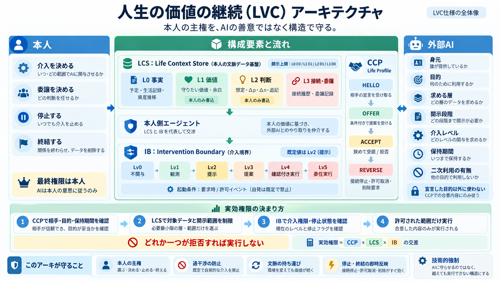

# AI 仕様：LVC から逆算した AI の考え方

[思想（LVC）](../principles/life-value-continuity.md)を、パーソナル AI の振る舞いとデータの扱いに落とした概念仕様。

> 本人の主権を、AI の善意ではなく構造で守る。

- この層は思想を実現する方法の一つであり、思想そのものではない。
- 思想と表現が食い違う場合は、思想を優先する。
- 実装と検証は実装者に委ねる。

## 文書

| 文書 | 責務 | 状態 |
|---|---|---|
| [common-principles.md](common-principles.md) | 三つの仕様に共通する原則（交差・技術的強制・統合テスト） | v0.2 |
| [ib-intervention-boundary.md](ib-intervention-boundary.md) | IB：何をさせるか（介入・実行の権限と停止状態） | v0.3 |
| [lcs-life-context-store.md](lcs-life-context-store.md) | LCS：何を保持し、何を見せるか（データと開示範囲） | v0.3 |
| [CCP ライフプロファイル](https://github.com/VCDesign-org/continuity-claim-protocol/blob/main/docs/ja/life-profile.md)（CCP リポジトリ） | 誰と、どんな条件で接続するか（相手・目的・保持期間） | v0.3 |

読む順番は、共通原則 → IB → LCS を推奨する。
